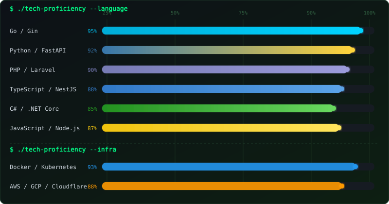
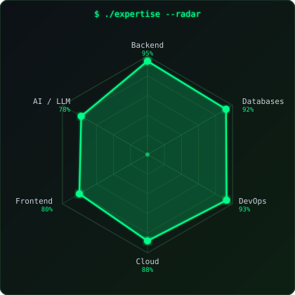
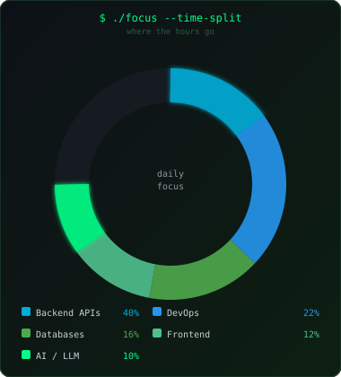

<div align="center">

<a href="https://www.buymeacoffee.com/rampesna" target="_blank">
  
</a>

---

# `$ whoami` — Talha Can

### Senior Backend Engineer · AI-Integrated Systems · Cloud & DevOps

<p>
  <a href="https://buymeacoffee.com/rampesna"></a>
  
</p>

</div>

---

## 👨‍💻 About Me

I'm a **Senior Backend Engineer** with a passion for building robust, scalable, and high-performance systems. My core expertise lies in designing distributed architectures, RESTful & event-driven APIs, and deploying production-grade services on cloud infrastructure.

- 🔧 Primarily work with **Go/Gin**, **Python/FastAPI**, **PHP/Laravel**, **Node.js/NestJS**, and **C#/.NET Core**
- 🎨 Proficient in frontend with **React** and **Vue.js**
- 🗄️ Deep experience with both **relational** (PostgreSQL, MySQL, MariaDB, SQLite) and **NoSQL** (MongoDB, Redis) databases
- ☁️ Hands-on with **Docker**, **Kubernetes**, **AWS**, **GCP**, **Cloudflare**, Linux server administration, and DNS management
- 🤖 Active experience in **AI-integrated software development**
- ⚡ Strong believer in clean architecture, CI/CD automation, and infrastructure-as-code principles

---

## 🛠️ Tech Stack

### 🚀 Languages


### ⚙️ Backend Frameworks


### 🎨 Frontend


### 🗄️ Databases


### ☁️ Cloud, DevOps & Infrastructure


### 🤖 AI / ML


### 🧰 Tools & Others


---

## 📊 Tech Proficiency

<div align="center">



</div>

<div align="center">


&nbsp;&nbsp;


</div>

---

## 🧬 Coding DNA

```
╔══════════════════════════════════════════════════════════════╗
║  rampesna@github  ~  Senior Backend Engineer                 ║
╠══════════════════════════════════════════════════════════════╣
║                                                              ║
║  $ cat philosophy.txt                                        ║
║                                                              ║
║  ▸ Write code that humans can read first, machines second    ║
║  ▸ Every system should be deployable in one command          ║
║  ▸ If it's not monitored, it's not in production             ║
║  ▸ Distributed doesn't mean complicated                      ║
║  ▸ The best API is one you never have to explain             ║
║                                                              ║
║  $ uptime                                                    ║
║  coding since 2015 · still compiling...                      ║
║                                                              ║
╚══════════════════════════════════════════════════════════════╝
```

---

## 📡 Currently Exploring

<div align="center">

| Domain | Focus |
|:--|:--|
| 🦾 **AI Systems** | Building LLM-integrated microservices & agentic pipelines |
| 🌐 **Edge Computing** | Deploying ultra-low-latency APIs at the edge with Cloudflare Workers |
| 🔬 **Observability** | Deep-dive into distributed tracing (OpenTelemetry, Jaeger) |
| ⚙️ **Platform Eng** | Internal developer platforms, GitOps workflows & Helm charts |

</div>

---

<div align="center">

```
╭─────────────────────────────────────────╮
│                                         │
│   If my work helped you, fuel the       │
│   next commit ☕                        │
│                                         │
╰─────────────────────────────────────────╯
```

[](https://buymeacoffee.com/rampesna)
&nbsp;


<sub>— crafted with intention, not a template —</sub>

</div>
